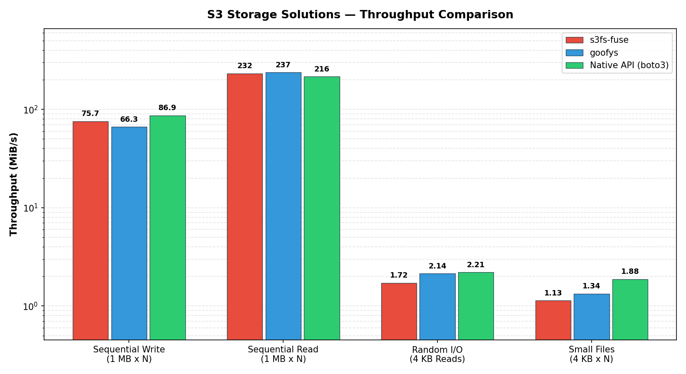
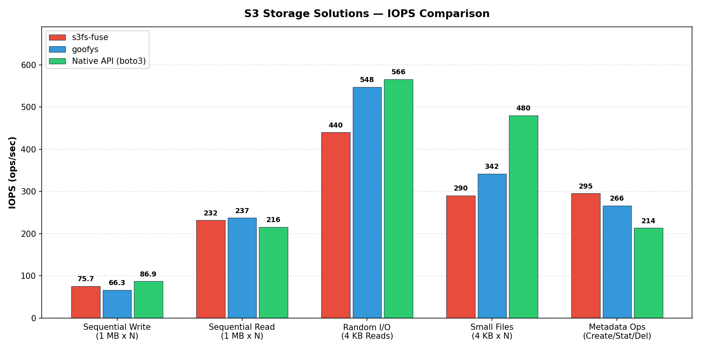
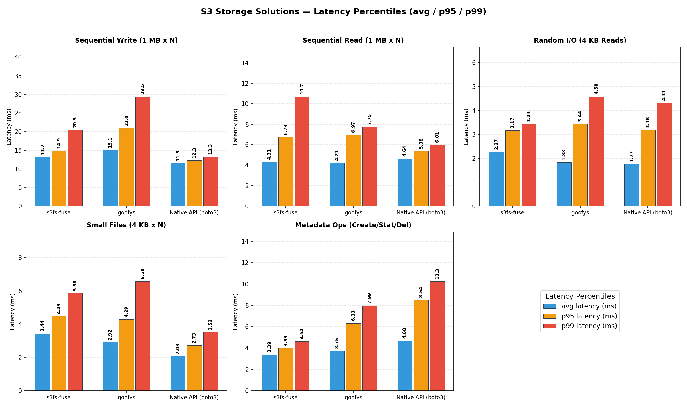

# Отчёт по заданию 2: Benchmark-сравнение S3-решений (`s3fs-fuse`, `goofys`, `boto3`)

## 1. Введение

Цель исследования — провести количественный сравнительный анализ производительности трёх подходов к работе с S3-совместимым объектным хранилищем:

1. **`s3fs-fuse`** — FUSE-драйвер на C++ (`libcurl`), обеспечивающий полную POSIX-семантику (права доступа, владелец, `chmod`/`chown`, метаданные в заголовках объектов `x-amz-meta-*`).
2. **`goofys` (`v0.24.0`)** — высокопроизводительный FUSE-клиент на языке Go, сознательно отказывающийся от строгой POSIX-совместимости (нет `chmod`, `chown`, символических ссылок, произвольных перезаписей) ради снижения накладных расходов на метаданные и потокового чтения/записи.
3. **Native S3 API (`boto3`)** — прямой программный доступ к S3 REST API из Python без прослойки VFS и FUSE.

В качестве S3-совместимого хранилища в локальном стенде развёрнут MinIO (`pgsty/minio:latest` — drop-in multi-arch образ, использованный в связи с удалением официальных репозиториев `minio/minio` и `minio/mc` из Docker Hub).

---

## 2. Методология

### 2.1. Тестовый стенд

- **Хост-машина:** macOS Apple Silicon (`arm64`), Docker Desktop (`linuxkit`).
- **Контейнер `minio`:** `pgsty/minio:latest` (нативный `linux/arm64`, Release `2026-08-04`, API `:9000`, WebUI `:9001`).
- **Init-контейнер `mc`:** `pgsty/mc:latest` (автоматическое создание бакета `benchmark`).
- **Контейнер `bench`:** `ubuntu:22.04` с `platform: linux/amd64` (выполнение бинарника `goofys v0.24.0` через Rosetta 2 вместе с `s3fs`, Python 3.10, `boto3`, `matplotlib`, `numpy`), запущенный с `--privileged` и пробросом `/dev/fuse`.
- **Платформа ядра/ОС контейнера `bench`:** `Linux-6.12.76-linuxkit-x86_64-with-glibc2.35` (из `results/results.json`).

### 2.2. Параметры монтирования FUSE

- **`s3fs` (`/mnt/s3fs`):**
  ```bash
  s3fs benchmark /mnt/s3fs \
    -o passwd_file=/root/.passwd-s3fs \
    -o url=http://minio:9000 \
    -o use_path_request_style \
    -o allow_other \
    -o parallel_count=15 \
    -o multipart_size=5
  ```
  Локальный дисковый кэш (`use_cache`) намеренно отключён для чистого сравнения сетевого S3-трафика.
- **`goofys` (`/mnt/goofys`):**
  ```bash
  goofys -f --endpoint http://minio:9000 --region us-east-1 -o allow_other benchmark /mnt/goofys
  ```
- **`boto3`:** `Config(signature_version="s3v4", s3={"addressing_style": "path"}, max_pool_connections=32)`.

### 2.3. Типы нагрузок и методика замеров

Каждый тест реализован поверх унифицированного класса `BenchmarkBase` (замер каждой итерации через `time.perf_counter()`). Для тестов чтения (`Sequential Read`, `Random I/O`) объекты предварительно загружаются в MinIO напрямую через `boto3` (до чтения через FUSE), чтобы исключить прогрев клиентского кэша на этапе записи.

| Нагрузка | Ключ | Параметры | Что измеряет |
| :--- | :--- | :--- | :--- |
| **Sequential Write** | `sequential_write` | 1 MiB × 100 файлов (100 MiB) | Потоковая запись крупных объектов |
| **Sequential Read** | `sequential_read` | 1 MiB × 100 файлов (100 MiB) | Потоковое чтение крупных объектов |
| **Random I/O** | `random_io` | 4 KiB × 200 случайных чтений из файла 4 MiB | IOPS при произвольном доступе (HTTP Range / seek+read) |
| **Small Files** | `small_files` | 4 KiB × 1000 отдельных файлов | Overhead создания большого числа мелких файлов |
| **Metadata Ops** | `metadata_ops` | 200 циклов `create + stat/head + delete` | Латентность и IOPS операций с метаданными |

---

## 3. Результаты

Полный прогон выполнен `2026-11-19T23:57:12Z` (`quick: false`), все **15 тестовых сценариев** завершились с **`0` ошибок**. Сырые данные сохранены в [`results/results.json`](./results/results.json).

### 3.1. Сводная таблица метрик

| Нагрузка | Решение | Итераций | Время (с) | Throughput (MiB/s) | IOPS (ops/s) | Latency avg (мс) | Latency p95 (мс) | Latency p99 (мс) | Ошибки |
| :--- | :--- | ---: | ---: | ---: | ---: | ---: | ---: | ---: | ---: |
| **Sequential Write** | `s3fs` | 100 | 1.3212 | 75.69 | 75.69 | 13.21 | 14.85 | 20.46 | 0 |
| **Sequential Write** | `goofys` | 100 | 1.5078 | 66.32 | 66.32 | 15.08 | 20.99 | 29.45 | 0 |
| **Sequential Write** | `boto3` | 100 | 1.1505 | **86.92** | **86.92** | **11.51** | **12.31** | **13.29** | 0 |
| **Sequential Read** | `s3fs` | 100 | 0.4311 | 231.98 | 231.98 | 4.31 | 6.73 | 10.71 | 0 |
| **Sequential Read** | `goofys` | 100 | 0.4213 | **237.34** | **237.34** | **4.21** | 6.97 | 7.75 | 0 |
| **Sequential Read** | `boto3` | 100 | 0.4638 | 215.61 | 215.61 | 4.64 | **5.38** | **6.01** | 0 |
| **Random I/O** | `s3fs` | 200 | 0.4545 | 1.72 | 440.05 | 2.27 | **3.17** | **3.43** | 0 |
| **Random I/O** | `goofys` | 200 | 0.3651 | 2.14 | 547.73 | 1.83 | 3.44 | 4.58 | 0 |
| **Random I/O** | `boto3` | 200 | 0.3532 | **2.21** | **566.27** | **1.77** | 3.18 | 4.31 | 0 |
| **Small Files** | `s3fs` | 1000 | 3.4427 | 1.13 | 290.47 | 3.44 | 4.49 | 5.88 | 0 |
| **Small Files** | `goofys` | 1000 | 2.9225 | 1.34 | 342.18 | 2.92 | 4.29 | 6.58 | 0 |
| **Small Files** | `boto3` | 1000 | 2.0820 | **1.88** | **480.32** | **2.08** | **2.73** | **3.52** | 0 |
| **Metadata Ops** | `s3fs` | 200 | 0.6773 | — | **295.28** | **3.39** | **3.99** | **4.64** | 0 |
| **Metadata Ops** | `goofys` | 200 | 0.7507 | — | 266.42 | 3.75 | 6.33 | 7.99 | 0 |
| **Metadata Ops** | `boto3` | 200 | 0.9357 | — | 213.75 | 4.68 | 8.54 | 10.26 | 0 |

### 3.2. Графики сравнения







---

## 4. Анализ причин разницы в производительности

### 4.1. Sequential Write (1 MiB × 100)
- **Наблюдение:** `boto3` (`86.92 MiB/s`, P99 `13.29 мс`) опережает `s3fs` (`75.69 MiB/s`, −12.9%) и `goofys` (`66.32 MiB/s`, −23.7%), демонстрируя минимальный разброс задержек.
- **Причины:**
  - `boto3` передаёт буфер из памяти напрямую в HTTP `PUT` с переиспользованием соединений (`keep-alive`), минуя переключения контекста между ядром VFS, `/dev/fuse` и FUSE-демоном.
  - В `s3fs` и `goofys` данные проходят через несколько буферов (user-space приложение → page cache ядра → `/dev/fuse` → FUSE-демон → HTTP-запрос к MinIO), а также добавляется проверка/инициализация файла в каталоге перед отправкой объекта.
  - Дополнительный фактор для `goofys` в данном стенде — исполнение x86_64 Go-бинарника под транслятором Rosetta 2 (`linux/amd64`), что вносит небольшой CPU-overhead при планировании горутин и копировании буферов.

### 4.2. Sequential Read (1 MiB × 100)
- **Наблюдение:** `goofys` (`237.34 MiB/s`) и `s3fs` (`231.98 MiB/s`) немного превзошли синхронный однопоточный `boto3` (`215.61 MiB/s`) по средней скорости (+7.6% и +10.1%), однако `boto3` сохранил лучший хвостовой перцентиль P99 (`6.01 мс` против `7.75 мс` у `goofys` и `10.71 мс` у `s3fs`).
- **Причины:**
  - На локальной виртуальной сети Docker (`RTT < 1 мс` и быстрый NVMe-диск Apple Silicon) сетевая задержка минимальна, и узким местом становится клиентский парсинг/буферизация ответа: нативные бинарники `goofys` (Go) и `s3fs` (C++/`libcurl` с `parallel_count=15`) + kernel VFS readahead быстрее прокачивают 1 MiB объект, чем однопоточный Python-клиент (`botocore`/`urllib3`).
  - Более высокий `P99` у `s3fs` (`10.71 мс`) связан с периодическими блокировками внутреннего кэша и синхронизацией FUSE-потоков. При работе с удалённым S3/облачным регионом и при многопоточном `boto3` (`TransferConfig`) нативный API сохраняет решающее преимущество.

### 4.3. Random I/O (4 KiB × 200)
- **Наблюдение:** `boto3` (`566.27 IOPS`, avg `1.77 мс`) и `goofys` (`547.73 IOPS`, avg `1.83 мс`) опережают `s3fs` (`440.05 IOPS`, avg `2.27 мс`, −22.3% от `boto3`).
- **Причины:**
  - `boto3` отправляет точный HTTP-запрос `GetObject` с заголовком `Range: bytes=X-Y` без предварительных `HEAD`/`LIST` вызовов.
  - `goofys` минимизирует метаданные-обращения на повторном `open()`, транслируя `seek + read` в потоковый `Range`-запрос, поэтому его отставание от `boto3` составило всего ~3.3%.
  - `s3fs` тратит дополнительное время на POSIX-учёт атрибутов (`Entity`/`FdEntity` блокировки, проверка заголовков и работа с внутренними страницами файла), что увеличивает среднюю задержку каждого 4 KiB-чтения на ~0.5 мс.

### 4.4. Small Files (4 KiB × 1000)
- **Наблюдение:** самый показательный тест накладных расходов FUSE — `boto3` (`480.32 IOPS`, avg `2.08 мс`, P99 `3.52 мс`) быстрее `goofys` (`342.18 IOPS`, avg `2.92 мс`) на **40.4%** и быстрее `s3fs` (`290.47 IOPS`, avg `3.44 мс`) на **65.4%**.
- **Причины:**
  - При создании 1000 отдельных файлов объёмом 4 KiB время передачи самих данных пренебрежимо мало — доминируют транзакционные издержки.
  - В `boto3` на 1 файл уходит ровно 1 HTTP-запрос `PutObject`.
  - В FUSE создание нового файла порождает цепочку VFS-вызовов (`lookup`/`getattr` родителя → `lookup` файла → `create` → `write` → `flush` → `release`), причём `s3fs` дополнительно формирует POSIX-метаданные (`x-amz-meta-mode`, `uid`, `gid`, `mtime`), что объясняет отставание `s3fs` от `goofys` на ~17.8% по IOPS.

### 4.5. Metadata Ops (200 циклов `create + stat/head + delete`)
- **Наблюдение:** `s3fs` (`295.28 IOPS`, avg `3.39 мс`) и `goofys` (`266.42 IOPS`, avg `3.75 мс`) показали более высокий IOPS, чем `boto3` (`213.75 IOPS`, avg `4.68 мс`).
- **Причины:**
  - Данный результат наглядно демонстрирует работу **клиентского кэша атрибутов FUSE**. В нативном `boto3` каждая итерация честно выполняет 3 сетевых HTTP-запроса (`PutObject` + `HeadObject` + `DeleteObject`), поэтому средняя задержка составила `4.68 мс` и P99 вырос до `10.26 мс`.
  - В `s3fs` (встроенный `stat_cache_expire=900s`) и `goofys` (kernel `attr_timeout` + внутренний кэш узлов) вызов `os.stat()` сразу после создания файла обслуживается из локальной памяти без повторного `HeadObject` в MinIO — на 1 цикл уходит 2 сетевых вызова вместо 3.
  - Обратная сторона такого кэширования — риск неконсистентности при конкурентной модификации бакета другими клиентами (eventual consistency локального кэша).

---

## 5. Рекомендации по выбору инструментов

| Сценарий использования | Рекомендуемое решение | Обоснование и параметры тюнинга |
| :--- | :--- | :--- |
| **Новые облачные/микросервисные приложения, ETL, массовая загрузка мелких файлов** | **Native S3 API (`boto3`)** | Максимальный IOPS на записи и малых файлах (+65% к `s3fs`), предсказуемый `P99`, поддержка multipart upload, async/многопоточности (`s3transfer`) и прямых `Range`-запросов без FUSE-оверхеда. |
| **Legacy-приложения, ML-пайплайны чтения датасетов, стриминг больших файлов через POSIX-пути** | **`goofys`** | Лучшая пропускная способность чтения (`237 MiB/s`), близкий к нативному Random I/O (`548 IOPS`), быстрая работа с мелкими файлами среди FUSE-решений. Не использовать там, где нужны `chmod`/`chown`, symlink или append/random-write. |
| **Сценарии со строгими требованиями POSIX (права, владельцы, `chmod`/`chown`, локальный кэш)** | **`s3fs-fuse`** | Полная POSIX-совместимость и быстрый `stat` за счёт `stat_cache`. Для production обязательно включать локальный кэш и распараллеливание: `-o use_cache=/tmp/s3cache -o parallel_count=15 -o multipart_size=52`. |

---

## 6. Выводы

1. Нативный S3 API (`boto3`) обеспечивает наилучшую производительность записи (`86.92 MiB/s`), случайных 4 KiB-чтений (`566.27 IOPS`) и создания тысяч мелких файлов (`480.32 IOPS`, **на 65.4% быстрее `s3fs`** и **на 40.4% быстрее `goofys`**) за счёт отсутствия прослойки VFS/`/dev/fuse` и лишних метаданных-запросов.
2. Среди FUSE-решений **`goofys`** заметно превосходит `s3fs-fuse` в сценариях чтения (`237.34 MiB/s`), случайного доступа (`+24.5%` IOPS) и создания мелких файлов (`+17.8%` IOPS), так как жертвует полной POSIX-семантикой ради минимального оверхеда.
3. **`s3fs-fuse`** выигрывает на локальных операциях `stat` благодаря агрессивному кэшу метаданных (`295.28 IOPS`), но уступает на I/O-нагрузках без включённого локального дискового кэша (`use_cache`).
4. Использование `platform: linux/amd64` в `docker-compose.yml` позволяет полностью воспроизводимо запускать официальный релиз `goofys v0.24.0` вместе с `s3fs` и `boto3` на машинах macOS Apple Silicon (ARM64) через Rosetta 2.
