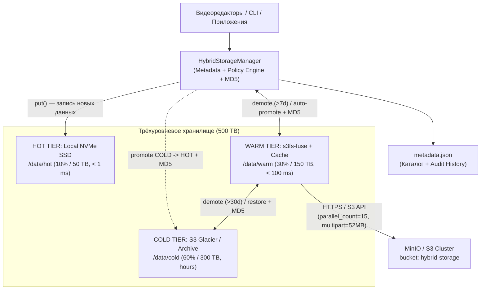

# Архитектура гибридного хранилища данных — TechData Solutions (500+ TB)

## 1. Executive Summary

**TechData Solutions** — медиа-компания, специализирующаяся на производстве, монтаже и долгосрочном хранении видеоконтента общим объёмом **500+ TB** с ежемесячным приростом 15–25 TB. Текущая модель хранения всего объёма на высокопроизводительных NVMe-массивах экономически неэффективна (около **\$50,000/мес**), несмотря на то что более **90% контента** после завершения монтажа не требует суб-10-миллисекундного отклика.

Предлагаемое решение — **трёхуровневая гибридная архитектура (HOT / WARM / COLD)** с автоматическим управлением жизненным циклом данных (ILM — Information Lifecycle Management) и прозрачным доступом к S3-хранилищу через FUSE (`s3fs`):

- **HOT (10% — 50 TB):** локальные NVMe SSD для активного монтажа и 4K/8K рендеринга (latency `< 10 мс`).
- **WARM (30% — 150 TB):** S3-совместимое объектное хранилище (MinIO / S3 Standard), подключённое через `s3fs-fuse` с локальным кэшированием (latency `< 100 мс`).
- **COLD (60% — 300 TB):** архивный объектный уровень класса S3 Glacier (восстановление за часы, минимальная стоимость хранения).

**Ключевой бизнес-эффект:** снижение совокупной стоимости владения (TCO) на **80%** — с **\$50,000/мес** до **\$10,000/мес**, что даёт экономию **\$480,000 в год** (**\$1.44 млн за 3 года**) без деградации SLA для активных проектов.

---

## 2. Бизнес-требования и SLA

| Категория данных | Доля / Объём | Паттерн доступа | Целевой SLA (Latency / RTO) | Требуемый Tier |
| :--- | :--- | :--- | :--- | :--- |
| **Активные проекты** (сырые исходники в работе, активный монтаж, превью) | 10% (~50 TB) | Непрерывный I/O 24/7, частая перезапись, высокий IOPS | **< 10 мс** (целевой < 1 мс локально), доступность 99.95% | **HOT** (NVMe SSD) |
| **Недавние проекты** (опубликованные релизы, повторный монтаж, ревизии) | 30% (~150 TB) | Ежедневное / эпизодическое чтение, редкая запись | **< 100 мс** (FUSE + кэш), доступность 99.9% | **WARM** (MinIO / S3 + `s3fs`) |
| **Долгосрочные архивы** (завершённые проекты старше 37 дней, мастер-копии) | 60% (~300 TB) | Крайне редкое чтение (аудит, переиздания, лицензирование) | Восстановление **от 1 до 12 часов** (RTO), durability 11x9 | **COLD** (S3 Glacier) |

### Нефункциональные требования
1. **Целостность данных:** обязательная проверка контрольных сумм (`MD5`) при каждой миграции (`demote`) и восстановлении (`promote`) до удаления исходной копии.
2. **Прозрачность доступа:** при обращении к файлу, находящемуся на `WARM` или `COLD`, система автоматически продвигает его в `HOT`, обновляет метрики доступа (`last_accessed`, `access_count`) и возвращает данные приложению.
3. **Персистентность метаданных:** каталог расположения объектов, счётчики обращений и аудит-лог сохраняются на диске (`metadata.json` в PoC; в production — PostgreSQL / SQLite + репликация).
4. **Безопасность:** шифрование при передаче (TLS), шифрование в покое (SSE-S3 / SSE-KMS), минимальные права доступа для сервисных учётных записей и изоляция контейнеров.

---

## 3. Архитектура решения и потоки данных

### 3.1. Общая архитектура (Mermaid)



### 3.2. Потоки данных (ASCII-схема)

```text
┌──────────────────────────────────────────────────────────────────────────┐
│                        ПОТОКИ ДАННЫХ И МИГРАЦИИ                          │
├──────────────────────────────────────────────────────────────────────────┤
│  1. ЗАПИСЬ (put):                                                        │
│     App ──▶ HybridStorageManager ──▶ [HOT: /data/hot] + MD5 + metadata   │
│                                                                          │
│  2. ЧТЕНИЕ (get) с AUTO-PROMOTE:                                         │
│     App ──▶ get(file)                                                    │
│       ├── если tier == HOT  ──▶ чтение с NVMe (< 1 мс)                   │
│       └── если tier != HOT  ──▶ _promote(WARM/COLD ──▶ HOT)              │
│                                 ├── shutil.copyfile()                    │
│                                 ├── проверка MD5 == metadata.checksum    │
│                                 └── удаление старой копии + обновление   │
│                                                                          │
│  3. ПЛАНОВАЯ МИГРАЦИЯ (migrate):                                         │
│     [HOT]  ──(age > 7 дней)──▶  [WARM: s3fs ──▶ MinIO]  ──(age > 30 д.)  │
│                                                              │           │
│                                                              ▼           │
│                                                           [COLD]         │
└──────────────────────────────────────────────────────────────────────────┘
```

### 3.3. Компоненты Docker PoC и особенности Apple Silicon (ARM64)

В директории [`task3_hybrid_storage/`](./) реализован воспроизводимый proof-of-concept на базе `docker-compose.yml`:

1. **`minio` (`pgsty/minio:latest`):** локальное S3-совместимое объектное хранилище (API `:9000`, Web Console `:9001`, нативный образ `linux/arm64` на Apple Silicon; использован drop-in форк `pgsty/*`, так как официальные репозитории `minio/minio` и `minio/mc` удалены из Docker Hub). Оснащён `healthcheck` по `/minio/health/live`.
2. **`createbuckets` (`pgsty/mc:latest`):** init-контейнер, дожидающийся healthy-статуса `minio` и создающий бакет `hybrid-storage`.
3. **`s3fs` (`Dockerfile.s3fs`):** привилегированный контейнер с `/dev/fuse`, монтирующий бакет `hybrid-storage` в `/mnt/s3` с оптимизированными опциями кэширования (`-o use_cache=/tmp/s3cache`, `-o parallel_count=15`, `-o multipart_size=52`, `-o stat_cache_expire=5`, `-o allow_other`).
4. **`app` (`Dockerfile.app`):** интерактивный менеджер гибридного хранилища (`app/hybrid_storage.py`, `app/cli.py`), подключающий три уровня:
   - `/data/hot` — том `hot_storage` (имитация NVMe);
   - `/data/warm` — FUSE-точка монтирования S3-бакета `hybrid-storage` (именованный том `s3fs_mount`);
   - `/data/cold` — том `cold_storage` (имитация Glacier).

> **Архитектурный нюанс Docker Desktop (macOS):** на нативном Linux для проброса FUSE-монтирования между контейнерами используется bind-mount propagation (`:rshared`). В Docker Desktop на macOS хост-путь проходит через VirtioFS и не поддерживает Linux kernel mount propagation (`is not a shared mount`), а именованные тома отклоняют `:shared` (`BindOptions must not be specified`). Чтобы `/data/warm` внутри `app` гарантированно работал напрямую с тем же бакетом MinIO, `scripts/app-entrypoint.sh` проверяет `grep -qs " /data/warm fuse" /proc/mounts` и при необходимости подключает `s3fs` непосредственно в namespace контейнера `app`, сохраняя 100% совместимость как с Linux, так и с Apple Silicon.

---

## 4. Политики миграции (Tiering & Auto-Promotion)

### 4.1. Правила жизненного цикла (ILM)

| Переход | Условие срабатывания | Действие | Проверка целостности |
| :--- | :--- | :--- | :--- |
| **Запись (`put`)** | Любой новый или перезаписанный файл | Размещение на `HOT`, расчёт MD5, удаление устаревших копий с `WARM`/`COLD` | Вычисление и сохранение эталонного MD5 |
| **Demote `HOT → WARM`** | `now - last_accessed > 7 дней` (604 800 с) | Копирование на `/data/warm` (`s3fs` → MinIO), удаление с `HOT` | Сверка MD5 целевого файла с `metadata.checksum` до `unlink` |
| **Demote `WARM → COLD`** | `now - last_accessed > 30 дней` (2 592 000 с) | Перенос с `WARM` на `/data/cold` (Glacier), удаление объекта из `WARM` | Сверка MD5 целевого файла с `metadata.checksum` до `unlink` |
| **Promote `WARM/COLD → HOT`** | Вызов `get(filename)` при `tier != HOT` | Автоматическое копирование в `HOT`, обновление `last_accessed`, `access_count += 1` | Сверка MD5 до удаления исходника и при чтении из `HOT` |

### 4.2. Протокол атомарности и защиты от «дёргания» (Anti-Thrashing)

1. **Copy-Verify-Delete:** ни один файл не удаляется с исходного уровня до успешного завершения `shutil.copyfile()` и полного совпадения MD5-хэша копии с эталоном в `metadata.json`. При несовпадении MD5 повреждённая копия удаляется, а транзакция прерывается с исключением `ValueError`.
2. **Атомарная запись метаданных:** обновление каталога `metadata.json` выполняется через временный файл `metadata.json.tmp` и системный вызов `os.replace()`.
3. **Защита от частых миграций (для production):** после автоматического promotion в `HOT` счётчик `last_accessed` сбрасывается на текущее время, гарантируя минимум 7 дней нахождения на `HOT` (cooldown window); для особо критичных проектов рекомендуется флаг `pinned=true`, запрещающий demote на время активного продакшена.

---

## 5. Экономический анализ (TCO) для 500 TB

Расчёт выполнен для общего объёма **500 TB (500 000 GB)** видеоконтента на основе типовых тарифов enterprise-хранилищ (облачные/on-prem эквиваленты NVMe block storage, S3 Standard / MinIO и Glacier Flexible Retrieval).

### 5.1. Сравнение ежемесячной, годовой и 3-летней стоимости

| Статья затрат | Сценарий A: Всё на NVMe (100% HOT) | Сценарий B: Гибридная схема (10% / 30% / 60%) |
| :--- | :--- | :--- |
| **HOT Tier (NVMe SSD, ~\$0.10/GB-мес)** | 500 000 GB × \$0.10 = **\$50,000 / мес** | 50 000 GB × \$0.10 = **\$5,000 / мес** |
| **WARM Tier (S3 Standard / MinIO, ~\$0.023/GB-мес)** | — (\$0) | 150 000 GB × \$0.023 = **\$3,450 / мес** |
| **COLD Tier (S3 Glacier Archive, ~\$0.004/GB-мес)** | — (\$0) | 300 000 GB × \$0.004 = **\$1,200 / мес** |
| **Операционные расходы (API-запросы, egress/retrieval буфер)** | Включено в массив (электричество/амортизация учтены в ставке) | **~\$350 / мес** (GET/PUT запросы + плановые восстановления из Glacier) |
| **ИТОГО в месяц** | **\$50,000 / мес** | **\$10,000 / мес** |
| **ИТОГО за 1 год** | **\$600,000 / год** | **\$120,000 / год** |
| **ИТОГО за 3 года** | **\$1,800,000** | **\$360,000** |

### 5.2. Итоговая экономия и анализ чувствительности

- **Ежемесячная экономия:** **\$40,000 / мес** (**80.0%**).
- **Годовая экономия:** **\$480,000 / год**.
- **Экономия за 3 года:** **\$1,440,000**.
- **Анализ чувствительности по восстановлениям (Retrieval):** при стандартном тарифе восстановления из Glacier (~ \$0.01/GB) даже при внеплановом поднятии **5% архива в месяц** (15 TB) дополнительные расходы составят `15 000 × $0.01 = $150/мес`, что укладывается в заложенный операционный буфер \$350/мес и сохраняет экономию на уровне **~79.7%**.

---

## 6. План поэтапного внедрения и мониторинга

### 6.1. Этапы внедрения (Roadmap)

| Этап | Срок | Основные работы | Критерий приёмки и откат |
| :--- | :--- | :--- | :--- |
| **Фаза 1: PoC и стенд** | Недели 1–2 | Развёртывание MinIO + `s3fs` + `HybridStorageManager` в Docker, функциональное тестирование `put`/`get`/`migrate`, нагрузочные тесты (см. Задание 2). | 100% прохождение циклов `HOT → WARM → COLD → HOT` без расхождения MD5. |
| **Фаза 2: Пилот на 50 TB** | Недели 3–5 | Перевод одного некритичного отдела (архивные монтажные проекты) на гибридную схему, отработка кэширования `s3fs` и cron-миграций в режиме `dry-run` → `active`. | Latency `HOT < 10 мс`, `WARM < 100 мс`; ноль жалоб от редакторов. Откат — копирование из S3 обратно на NAS. |
| **Фаза 3: Автоматизация и БД метаданных** | Недели 6–8 | Миграция `metadata.json` на отказоустойчивый PostgreSQL, запуск фонового планировщика ILM (Celery/cron), интеграция уведомлений о восстановлении из `COLD`. | Метаданные реплицируются, авто-продвижение работает многопоточно. |
| **Фаза 4: Промышленный rollout (500+ TB)** | Недели 9–12 | Поэтапная миграция исторических архивов (сначала > 37 дней в `COLD`, затем 7–30 дней в `WARM`), высвобождение 80–90% NVMe-ёмкостей. | Достижение целевого распределения 10/30/60% и подтверждение экономии TCO. |

### 6.2. Мониторинг и алертинг (Prometheus + Grafana)

| Метрика | Источник | Порог Warning | Порог Critical | Действие дежурного инженера |
| :--- | :--- | :--- | :--- | :--- |
| Заполненность `HOT` (`/data/hot`) | `node_exporter` | `> 75%` | `> 88%` | Внеочередной запуск `migrate` или снижение порога `hot_to_warm_days` (с 7 до 5 дней). |
| Доступность FUSE-монтирования `/data/warm` | Blackbox / script exporter (`mountpoint -q`) | 1 неудачная проверка | `>= 2` проверок подряд | Проверка контейнера/демона `s3fs`, `fusermount -uz` и перемонтирование. |
| Задержка чтения `WARM` (P95) | Экспортер приложения / MinIO metrics | `> 80 мс` | `> 100 мс` (нарушение SLA) | Увеличение локального кэша `use_cache` на SSD, проверка сети до S3. |
| Частота `auto-promote` из `COLD` | Метрика `hybrid_promote_total{from="cold"}` | `> 500 GB/сутки` | `> 2 TB/сутки` | Возможный thrashing или массовый пересмотр архивов — аудит паттернов и корректировка порога 30 дней. |
| Ошибки целостности `MD5` | Метрика `hybrid_md5_mismatch_total` | — | `> 0` | Немедленная блокировка удаления исходников, проверка дисков NVMe и журналов MinIO. |
